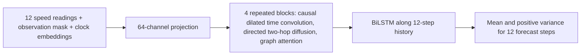

# Manuscript architecture interpretation

The uploaded manuscript describes a model that differs substantially from both
legacy `enhanced_gnn.py` and `corrected_experiment.py`. `paper_model.py` is a
separate implementation of its explicit equations. It is an **interpretation**,
not a validated reproduction of the reported UA-GNN or its claimed scores.



| Stage | Tensor shape |
| --- | --- |
| Inputs and time context | `[batch, 12 historical times, sensors, 18 features]` |
| Projection / each temporal and graph block | `[batch, 12, sensors, 64]` |
| LSTM sequence | `[batch × sensors, 12, 64]` |
| Bidirectional output | `[batch × sensors, 12, 128]` |
| Mean and variance heads | `[batch, sensors, 12 forecast times]` each |

The time convolution never traverses sensors. Graph multiplication and attention
never traverse historical time. `A[i,j]` denotes a directed neighbor `j`
contributing to output node `i`. Both row-normalized `A` and `A.T` are used to
orders one and two. Isolated rows stay zero. Attention uses self links. Unit
tests verify these conventions on a hand-built directed graph.

The manuscript does not uniquely define the attention residual and projection
structure, embedding width, sensor-mask augmentation probability, or exact
output-head layout. This implementation chooses 8 dimensions for each clock
embedding, a 10% full-history sensor mask in
training, and the manuscript's linear replacement of MSE by Gaussian NLL
across the first ten epochs. An earlier code version retained MSE at full
weight throughout training; its saved architecture pilot results are superseded.
At 64 hidden channels it has 222,480 learned parameters. The stated approximate
304,000 parameter count cannot be reproduced without omitted architecture
details or different layer choices.

`paper_experiment.py` uses the official METR-LA adjacency, the supplied
PEMS-BAY adjacency, a 70/10/20 chronological split, causal missing-input fill,
train-only scaling, validation-selected checkpoint, and one test evaluation.
It records actual hardware and sampled-window limits. A matched no-diffusion
switch is available via `--no-diffusion`. Separately trained `--no-dropout`
and `--no-aleatoric` configurations are also available. The latter trains on
MSE and evaluates epistemic variance alone, so its uncertainty scores describe
a different predictive distribution. Meaningful ablation claims require
the same train/validation/test windows, seed, budget, and evaluation settings.
`compare_ablation.py` enforces those saved-run fields, verifies identical
targets and masks, and reports a paired physical-MAE difference with a
descriptive contiguous-window block bootstrap.
The latest model, optimizer, scheduler, and random states are saved each epoch;
rerun the identical command with `--resume` after an interruption.

Example:

```bash
python paper_experiment.py --dataset PEMS-BAY --output paper_results/pems_seed42 --batch-size 64
python paper_experiment.py --dataset PEMS-BAY --output paper_results/pems_no_diffusion_seed42 --batch-size 64 --no-diffusion
python analyze_predictions.py paper_results/pems_seed42
python robustness_experiment.py paper_results/pems_seed42 --windows 128 --mc-passes 3
python mc_stability.py paper_results/pems_seed42 --windows 16
python compare_ablation.py paper_results/pems_seed42 paper_results/pems_no_diffusion_seed42
```

For a matched trained no-dropout check, rerun the same command with a new
output directory and `--no-dropout`. For a mean-only/no-aleatoric check, use
`--no-aleatoric`; that variant trains on MSE and its saved interval variance
contains only the MC component. `run_repetitions.py --paper` accepts these
switches for frozen five-seed runs and `--resume` continues interrupted runs
from their saved latest checkpoints. Compare only runs with the same loss
version, window samples, batch size, and seed.

On a CPU the four-block graph-attention model is expensive. Short sampled runs
are explicitly preliminary and cannot establish the manuscript's headline
accuracy, robustness, or ablation claims.
Matched one-seed, 20-epoch-cap pilots for diffusion, trained no-dropout, and
trained no-aleatoric configurations are now saved for both datasets. Their
paired scores, coverage, MC stability, and small sensor-failure checks are
reported in `MANUSCRIPT_RERUN_RESULTS.md`; none replaces the full multi-seed
benchmark.
On this five-core host, a measured PEMS-BAY batch-64 epoch with 256 sampled
train and 256 validation windows took about 90 seconds in a 20-epoch run.
A 50-epoch full-window run is therefore expected to take tens of hours per
seed; full five-seed experiments and trained ablations require a larger
compute budget. This is an extrapolation, not a measured full-run duration.
On this 33 GiB host, three simultaneous batch-64 paper-model processes
exhausted available memory during startup; run the experiment matrix
sequentially or measure resource use before adding parallel jobs.

`robustness_experiment.py` evaluates clean, independent random observation
dropout, a fixed set of failed sensors across the test sample, per-window
spatial clusters, and contiguous historical-time blocks. Rates are fractions
of sensor-time readings for random failure, sensors for persistent/clustered
failure, and historical steps for temporal blocks. Three corruption seeds and
10/20/30/40/50% rates are the defaults. Each condition compares normalized
train-median replacement with causal forward filling; the target mask and
window sample stay fixed. Spatial clusters are grown by breadth-first search
over the undirected union of the supplied graph, starting at a connected node.
The benchmarks have one large component (206/207 METR-LA sensors; 319/325
PEMS-BAY sensors). Isolated nodes are excluded as cluster starting points.
This is synthetic test-time stress testing, not
evidence of real hardware failure resilience. `analyze_predictions.py`
computes physical-unit CRPS, per-horizon metrics, and reliability plots from
saved predictions. `measure_efficiency.py` reports measured CPU batch latency
and process RSS for the current host.
For runs covering every test window, the prediction audit also reports the
paired MAE difference versus persistence with a 1,000-resample bootstrap of
contiguous 288-window blocks (roughly one day). This is a descriptive interval
that respects much of the overlap among forecast windows; it is not a formal
guarantee under traffic regime change.
Use `--mc-passes 3` or more in `robustness_experiment.py` when assessing
epistemic variance or interval widening; the default single deterministic
pass reports zero epistemic variance. The output records the pass count and
coverage/width for every failure condition. `--inference-seed` fixes the
dropout random stream for repeatability. `mc_stability.py` compares 5, 10,
30, and 50 passes on the same sampled windows and seed, so the 10-pass
full-test runs can be judged against a larger MC budget.
For a no-MC evaluation of a trained checkpoint on its saved test-window
sample, use `--clean-only --mc-passes 1 --windows N` with `N` equal to that
run's `test_windows` in `metrics.json` (or `windows.test` for the small
model). This changes inference only; it is not a retrained no-dropout model.

Interval coverage and CRPS use a moment-matched Gaussian with variance equal
to MC mean variance plus mean predicted aleatoric variance. This is a defined
approximation to the MC mixture, not a claim that the mixture is exactly
Gaussian. Coverage is computed only for observed targets after multiplying
standard deviations by the train-fitted per-sensor scale.
The prediction audit also recomputes 95% coverage after removing either
variance component from the saved MC prediction; this is a component-level
interval check, not a retrained no-MC or no-variance model ablation.
